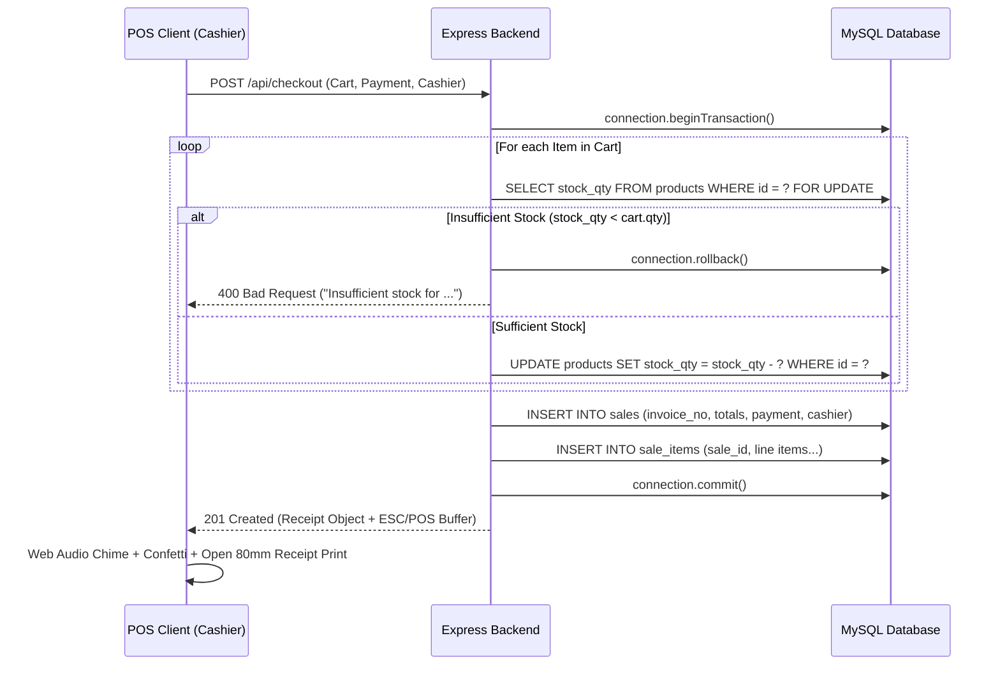

# Hachi Tech POS & Inventory Management System

A high-performance, production-ready Full-Stack Point of Sale (POS) and Inventory Management System designed for computer and tech hardware retailers (**"Hachi Tech POS"**). 

The application matches the clean, modern **"Hachiware"** light-mode aesthetic (#F8FAFC canvas, crisp white cards, rounded-2xl radii, pastel status pills, and light elevation shadows) with deep hardware integration:
- **USB Barcode Scanner (Keyboard-Wedge)**: High-speed keydown buffer capturing retail EAN/UPC barcodes in bursts (< 45ms) ending in `Enter`, with instant Web Audio API scanner beep feedback.
- **ACID Transactional Checkout**: Strict transactional inventory control (`connection.beginTransaction()`, row-level locking, rollback on insufficient stock, unique invoice generation, and real-time stock deduction).
- **Dual Receipt Engine**: Dedicated 80mm thermal receipt CSS print layout (`@media print`) and backend ESC/POS command generation for direct raw network/USB thermal printers (Epson, Star, Xprinter, Munbyn).

---

## 🚀 Quick Start Guide

### 1. Prerequisites
- **Node.js**: v18.0.0 or higher (v20+ recommended)
- **MySQL**: MySQL 8.0+ or MariaDB 10.4+ (Optional: Embedded local ACID storage mode is preconfigured out-of-the-box so you can run and test immediately!)

---

### 2. Database Setup (MySQL)

If using MySQL, configure your credentials in `backend/.env`:
```env
DB_HOST=127.0.0.1
DB_PORT=3306
DB_USER=root
DB_PASSWORD=your_mysql_password
DB_NAME=hachi_pos
```

Initialize the database schema and sample tech hardware inventory:
```bash
# From workspace root:
npm run init-db

# Or manually run schema.sql:
mysql -u root -p < schema.sql
```

> **Note**: If MySQL server is offline or authentication is pending, the backend automatically operates in **Resilient Local ACID Storage Mode**, persisting data to `backend/data/hachi_pos_local.json` with identical schema and transaction semantics.

---

### 3. Start the Backend Server

```bash
cd backend
npm install
npm start
```
- API Server runs at: `http://localhost:5000`
- API Health & Diagnostics: `http://localhost:5000/api/health`

---

### 4. Start the Frontend Application

```bash
cd frontend
npm install
npm run dev
```
- POS Terminal Web App runs at: `http://localhost:3000`

---

## 📦 Project Structure

```
c:\Users\WINDW 11 TESTING\Desktop\POS\
├── backend/
│   ├── data/                    # Fallback JSON transactional state
│   ├── scripts/
│   │   ├── init-db.js           # Database initialization script
│   │   └── test-api.js          # Automated end-to-end API test suite
│   ├── .env                     # Server and database environment configuration
│   ├── .env.example             # Example environment template
│   ├── db.js                    # MySQL2 connection pool + ACID transaction engine
│   ├── escpos.js                # ESC/POS 80mm binary command builder
│   ├── package.json             # Express, mysql2, cors, dotenv
│   ├── schema.sql               # MySQL DDL & Seed inventory data
│   └── server.js                # RESTful Express endpoints & checkout route
├── frontend/
│   ├── public/                  # Static assets
│   ├── src/
│   │   ├── components/
│   │   │   ├── HardwareSettingsModal.jsx # Scanner & ESC/POS diagnostics
│   │   │   ├── InventoryManager.jsx      # Stock management & quick restock
│   │   │   ├── Navbar.jsx                # Navigation, clock, scanner indicator
│   │   │   ├── PosTerminal.jsx           # Main Cashier Screen & Cart
│   │   │   ├── ProductModal.jsx          # Add/Edit product with barcode autofocus
│   │   │   ├── ReceiptModal.jsx          # 80mm Thermal Receipt preview & print
│   │   │   └── SalesHistory.jsx          # Audit ledger & reprint receipts
│   │   ├── utils/
│   │   │   ├── audio.js         # Web Audio API scanner beeps and register chimes
│   │   │   └── formatters.js    # Currency, date, and stock badge helpers
│   │   ├── api.js               # Axios API client
│   │   ├── App.jsx              # Main React application controller
│   │   ├── index.css            # Tailwind directives & @media print 80mm rules
│   │   └── main.jsx             # React DOM entry point
│   ├── index.html               # JetBrains Mono & Inter typography
│   ├── package.json             # React 18, Vite, Tailwind CSS, Lucide Icons
│   ├── tailwind.config.js       # Hachiware design system colors & shadows
│   └── vite.config.js           # Vite dev server + /api proxy to backend
├── schema.sql                   # Root copy of database initialization script
└── README.md                    # Documentation
```

---

## 🛒 Sample Tech Barcodes for Testing

Point your physical USB barcode scanner at these standard barcodes or type them into the quick-scan field in the POS terminal:

| Barcode | Product Description | Category | Selling Price |
| :--- | :--- | :--- | :--- |
| `097855171733` | Logitech MX Master 3S Wireless Mouse (Graphite) | Peripherals | $99.00 |
| `8886419337584` | Razer DeathAdder V3 Ergonomic Esports Mouse | Peripherals | $69.99 |
| `4895248805218` | Keychron K2 V2 Wireless Mech Keyboard | Peripherals | $79.50 |
| `840006638841` | Corsair K70 RGB PRO Mechanical Gaming Keyboard | Peripherals | $159.99 |
| `887276707327` | Samsung 990 PRO 1TB PCIe Gen4 NVMe M.2 SSD | Storage | $109.99 |
| `740617304121` | Kingston DataTraveler 64GB USB 3.2 Flash Drive | Storage | $7.50 |
| `856235006240` | iFixit Pro Tech Toolkit for Electronics & PCs | Tools | $74.99 |
| `6934177708572` | Xiaomi Precision 24-in-1 Magnetic Screwdriver Set | Tools | $21.50 |
| `4895212701838` | Arctic MX-4 (4g) High Performance Thermal Paste | Tools | $7.99 |
| `194644023249` | Anker PowerLine III USB-C to USB-C 100W Cable 6ft | Cables | $15.99 |
| `6957303874328` | UGREEN 8K HDMI 2.1 Ultra High Speed Cable 2M | Cables | $13.99 |
| `SRV-CLEAN-01` | PC Deep Cleaning & Thermal Repaste Service | Services | $25.00 |

---

## 🖨️ Hardware Integration Details

### 1. Global USB Barcode Scanner Wedge Listener
- Physical USB laser or CCD scanners emulate standard keyboard HID input.
- Keystrokes arriving with an average duration under 45ms ending in `Enter` are automatically intercepted globally regardless of where cursor focus is on screen.
- Scanned barcodes instantly trigger product lookup, audio confirmation (`playScanBeep()`), and 1-click cart addition.

### 2. 80mm Thermal Receipt Printing (`@media print`)
- When checking out or clicking **"Print 80mm Receipt"**, CSS `@media print` rules:
  - Isolate the designated `#thermal-receipt-print-zone` container (width 76mm, font monospace, zero margins).
  - Strip all screen UI, headers, navigation bars, and buttons.
  - Generates store header, itemized breakdown, tax/discount lines, invoice barcode, and warranty disclaimer.

### 3. ESC/POS Command Generation (`/api/print`)
- Formats standard ESC/POS command sequences:
  - Initialize printer (`ESC @`)
  - Center alignment (`ESC a 1`)
  - Character sizing (`GS ! 0x11`)
  - Double and single divider dashed lines
  - Tabulated two-column and three-column line item formatting
  - Code 128 barcode generation (`GS k 73`)
  - Partial paper cut (`GS V 66 0`)
- Generates binary buffers, hex string streams, and direct socket transmissions to network thermal printers (port 9100).

---

## 📡 REST API Reference

| Method | Endpoint | Description |
| :--- | :--- | :--- |
| `GET` | `/api/health` | System health check & active database connection diagnostics |
| `GET` | `/api/products` | Retrieve catalog with `?q=` search and `?category=` filter |
| `GET` | `/api/products/barcode/:code` | Instant retail box barcode lookup |
| `GET` | `/api/products/:id` | Single product details by ID |
| `POST` | `/api/products` | Add new product with duplicate barcode validation |
| `PUT` | `/api/products/:id` | Update product details or restock quantity |
| `DELETE` | `/api/products/:id` | Delete product from catalog |
| `POST` | `/api/checkout` | **ACID Transaction**: Stock check, decrements, sales record, receipt return |
| `GET` | `/api/sales` | Transaction history & daily revenue/orders/stock KPI metrics |
| `POST` | `/api/print` | ESC/POS thermal command generation & LAN transmission |

---

## 🛡️ ACID Checkout Transaction Workflow



---

## 🌐 Production Cloud & Linux VM Deployment

### Option A: One-Command Automated Ubuntu Cloud VM Deploy
On any fresh Ubuntu 20.04/22.04/24.04 LTS instance (AWS EC2, DigitalOcean, Oracle Cloud):
```bash
git clone <your-repo-url>
cd POS
chmod +x deploy-ubuntu.sh
./deploy-ubuntu.sh
```
This script installs Node.js 20 LTS, Nginx reverse proxy, PM2 process manager, builds the frontend, and starts the system.

### Option B: Docker & Docker Compose
```bash
# Starts both MySQL 8 and the POS application in isolated containers:
docker compose up -d --build
```
Accessible at `http://<your-server-ip>:5000`

### Option C: Single-Service Production Node.js Server
```bash
# Build frontend assets and start backend serving frontend/dist on port 5000:
npm run build
npm run start:prod
```

### 🔐 Cashier Authentication PINs
| Cashier Name | Role | PIN |
| :--- | :--- | :--- |
| **Alex S.** | Senior Cashier | `1234` |
| **David S.** | Store Manager | `9999` |
| **Srey Mao** | Junior Cashier | `0000` |
